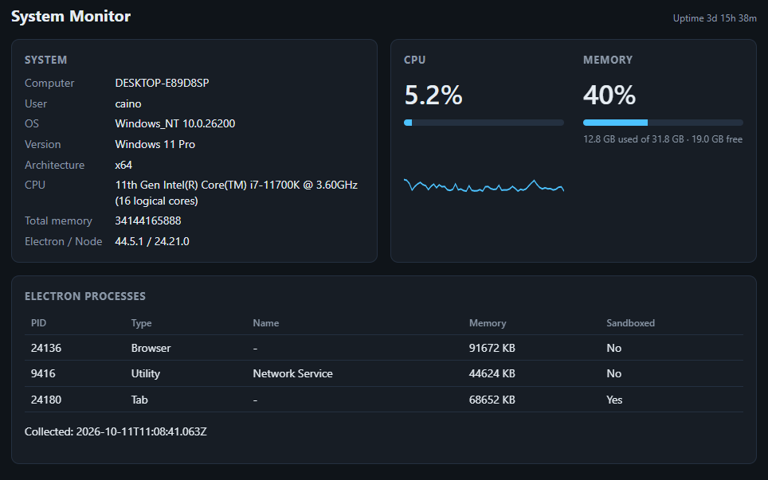

# System Monitor

A Windows-focused desktop system monitor built with Electron. It displays system information, live CPU and memory usage, CPU usage history, and Electron process metrics through a dashboard UI.

The project explores Electron's main, renderer and preload processes, controlled IPC communication, Windows system integration and security practices for desktop applications.

## Screenshot



## What it demonstrates

| Requirement | Where |
|---|---|
| Electron app | `src/main.js` |
| Renderer UI | `src/renderer/` (HTML, CSS, JS) |
| Preload script | `src/preload.js` |
| IPC | `ipcMain.handle` in `main.js`, `ipcRenderer.invoke` in `preload.js` |
| Node.js in the main process | `os`, `child_process.execFile` |
| Windows system info | `os.*` |
| CPU / memory / electron process display | live gauges, CPU history chart, electron processes |
| Secure IPC API | narrow `window.sysmon` API, read-only, no raw `ipcRenderer` exposed |
| `contextIsolation` | `true` in `BrowserWindow` `webPreferences` |
| No Node in the renderer | `nodeIntegration: false`, `sandbox: true` |
| Windows installer | `electron-builder` NSIS target (`npm run dist`) |

## Run it

```bash
npm install
npm start
```

## Build the Windows installer

Run this on Windows:

```bash
npm run dist
```

The installer is written to `dist/System Monitor Setup 1.0.0.exe`.

## Security notes

- `contextIsolation: true`, `nodeIntegration: false`, `sandbox: true`.
- The preload exposes three named, read-only functions through `contextBridge`. There is no generic `send`/`invoke` passthrough.
- Every `ipcMain.handle` checks that the sender is the app's own local `index.html` before doing anything.
- A strict Content Security Policy blocks inline scripts, remote scripts and remote connections.
- New windows and navigation away from the app page are denied.
- The renderer builds DOM with `textContent`, never `innerHTML`, so process names cannot inject markup.
- `execFile` is used with fixed arguments (no shell, no user input).


## Project layout

```
SystemMonitor/
├── package.json
└── src/
    ├── main.js          # main process: window, system info, IPC handlers
    ├── preload.js       # contextBridge API
    └── renderer/
        ├── index.html
        ├── style.css
        └── renderer.js
```

## Ideas to progress the application

- Add an app icon (`build/icon.ico`) and set `win.icon` in `package.json`.
- Add top currently used processes with Per-process CPU via PowerShell `Get-Process` or `Get-Counter`.
- Disk and network usage panels.